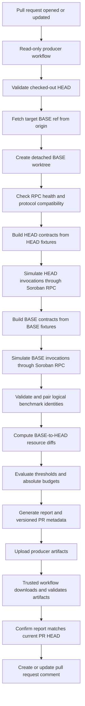
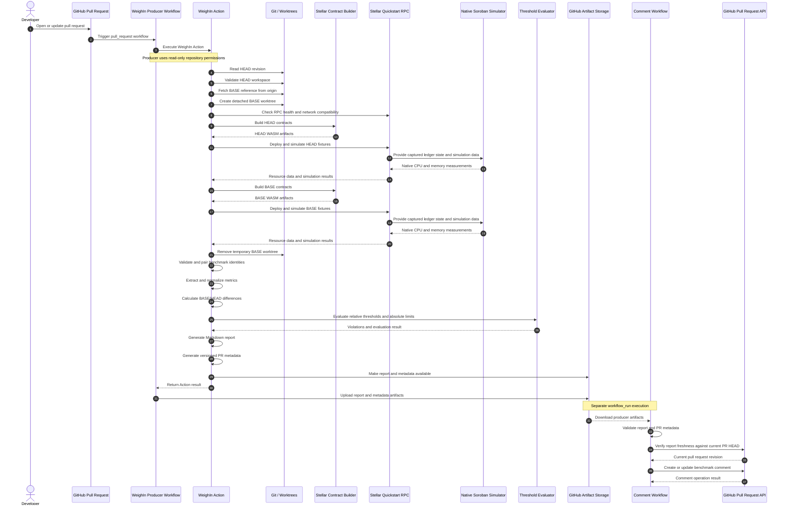

# WeighIn Architecture

This document explains how WeighIn measures Soroban smart contract resource
usage, compares pull request changes against a baseline revision, evaluates
configured thresholds, and publishes benchmark reports.

## System Overview

WeighIn consists of four major components:

1. **GitHub Actions producer workflow** — starts the benchmark process with
   read-only repository permissions.
2. **WeighIn GitHub Action** — checks out BASE and HEAD revisions, builds
   contracts, performs RPC simulations, extracts resource metrics, and
   evaluates regression policies.
3. **Artifact storage** — transports the generated report and pull request
   metadata between independent GitHub Actions workflows.
4. **Comment consumer workflow** — executes trusted workflow code with
   permission to publish or update a pull request comment.

The standalone CLI is also available for measuring existing contract WASM
artifacts locally. It does not perform the complete BASE/HEAD comparison or
GitHub comment workflow.

## Pull Request Measurement Flow

The flowchart shows the major stages and the separate trusted comment
workflow. The producer starts with the pull request HEAD already checked out;
it fetches the target BASE ref and creates a detached worktree rather than
checking out a merge base.



The sequence below gives more detail about the component interactions.



## Measurement Pipeline

The measurement pipeline consists of the following stages.

### 1. Pull Request Trigger

The producer workflow runs when a pull request is opened or updated.

The workflow executes with read-only repository permissions. This prevents
untrusted pull request code from receiving permission to modify pull requests
or access privileged write operations.

### 2. HEAD and BASE Checkout

The HEAD revision is the pull request workspace already checked out by
`actions/checkout`.

WeighIn fetches the configured BASE reference from `origin` and creates a
separate detached Git worktree using:

```bash
git fetch --depth=1 origin <base-ref>
git worktree add --detach <temporary-directory> FETCH_HEAD
```

The BASE worktree is isolated from the HEAD workspace and is removed after
measurement.

The BASE revision defaults to the pull request's base branch, or `main`
when no pull request base branch is available. An explicit `base-ref` can
override this behavior.

WeighIn compares against the fetched BASE revision; it does not calculate a
Git merge base.

### 3. Contract Building

Each revision is built independently using its own fixture declarations.

The default builder uses the locked, optimized Stellar contract build process
and the modern `wasm32v1-none` target.

The Action verifies the selected contract packages and generated WASM
artifacts before measurement.

Custom build commands and prebuilt WASM modes are available, but they bypass
some of the default builder guarantees.

### 4. RPC Simulation

WeighIn uses a compatible standalone Stellar RPC endpoint.

The Action verifies RPC health, network passphrase, and protocol compatibility
before performing measurements.

For each configured invocation, WeighIn:

- Deploys the required contract WASM.
- Prepares and executes the configured simulation.
- Captures the required ledger state and network configuration.
- Uses the native Soroban simulation helper for consumed CPU and memory.
- Validates the returned simulation data and provenance.

The supported default measurement environment is Linux x64 with protocol 28.

### 5. Metric Extraction

The measurement layer extracts the supported resource metrics from RPC
simulation data and native simulation results.

Each measurement records its source, applicable resource limit, and
availability information.

Unavailable metrics are represented explicitly with null consumption values
and a reason. They must not be interpreted as measured zero values.

See [Metric Provenance](metric-provenance.md) for metric definitions and
measurement sources.

### 6. Diff Generation

The BASE and HEAD measurement records are compared using logical benchmark
identity rather than relying solely on runtime contract addresses.

The comparison calculates:

- BASE consumption.
- HEAD consumption.
- Absolute change.
- Percentage change where a percentage can be calculated.
- Regression or improvement status.
- New and removed benchmark cases.

Positive deltas indicate increased resource consumption.

### 7. Threshold Evaluation

The threshold evaluator loads and validates the applicable `weighin.toml`
configuration.

It evaluates:

- Global regression rules.
- Function-specific regression rules.
- Aggregate resource budgets.
- Absolute resource limits.

A threshold violation causes the Action to report failure.

An absent configuration does not enforce regression thresholds.

### 8. Report and Metadata Generation

The Action generates a Markdown benchmark report and, when configured,
versioned pull request metadata.

The report includes comparison results, metric changes, provenance and
threshold violations.

The report is also made available through the GitHub Actions job summary.

### 9. Artifact Upload

The producer workflow uploads the report and metadata as a GitHub Actions
artifact.

Artifact upload is independent of the commenting operation. The report can
therefore remain available for inspection even when the benchmark policy
fails.

### 10. Separate Comment Workflow

A second workflow listens for completion of the producer workflow through
`workflow_run`.

It downloads the generated artifacts, validates the report and metadata,
checks that the report still corresponds to the current pull request revision,
and creates or updates the benchmark comment.

The consumer runs trusted workflow code from the base repository rather than
executing downloaded pull request code with a write token.

Producer and consumer versions must be compatible because they share a
versioned metadata contract.

## Security Boundaries

The two-workflow design is an important security boundary.

| Component | Responsibility | Permissions |
|---|---|---|
| Producer workflow | Build and measure pull request changes | `contents: read` |
| Artifact storage | Transfer generated reports and metadata | Artifact access |
| Comment workflow | Validate artifacts and publish PR comments | `contents: read`, `actions: read`, `pull-requests: write` |

### Why two workflows are necessary

Pull requests can originate from forks. Code submitted by a fork must not
automatically receive a token capable of writing comments or modifying the
base repository.

The producer therefore performs measurement without requiring pull request
write permissions.

The trusted consumer separately processes the producer's artifacts and
performs the commenting operation.

This separation reduces the risk of exposing privileged credentials to
untrusted pull request code.

## Relevant Source Files

| File | Responsibility |
|---|---|
| `action.yml` | GitHub Action inputs, outputs and entry point |
| `src/action.ts` | Main BASE/HEAD orchestration |
| `src/cli.ts` | Standalone entry point for measuring fixture invocations from existing WASM; does not orchestrate the full GitHub BASE/HEAD workflow |
| `src/measurement.ts` | Deploys benchmark WASM as needed and coordinates per-invocation measurement |
| `src/simulation.ts` | Soroban RPC simulation, ledger-state capture and native helper validation |
| `src/diff.ts` | Pairs BASE/HEAD benchmarks by logical identity and computes resource deltas |
| `src/threshold.ts` | Loads and evaluates regression thresholds, aggregate budgets and absolute limits |
| `src/comment.ts` | Renders and creates or updates the WeighIn pull request report comment |
| `src/comment-action.ts` | Trusted artifact consumer that validates producer output before comment publication |
| `src/build-selection.ts` | Contract build selection |
| `src/build.ts` | Contract build process |
| `src/record-schema.ts` | Measurement record schema and metric keys |
| `src/config.ts` | Fixture and policy configuration schema validation |
| `src/report.ts` | Markdown report and metadata generation |
| `.github/workflows/weighin.yml` | Example producer workflow |
| `.github/workflows/weighin-comment.yml` | Example consumer workflow |

## Further Reading

- [CLI Usage](CLI.md)
- [Configuration Reference](CONFIGURATION.md)
- [Integration Guide](INTEGRATION-GUIDE.md)
- [Metric Provenance](metric-provenance.md)
- [Known Limitations](KNOWN_LIMITATIONS.md)
- [Existing Architecture Notes](architecture.md)
